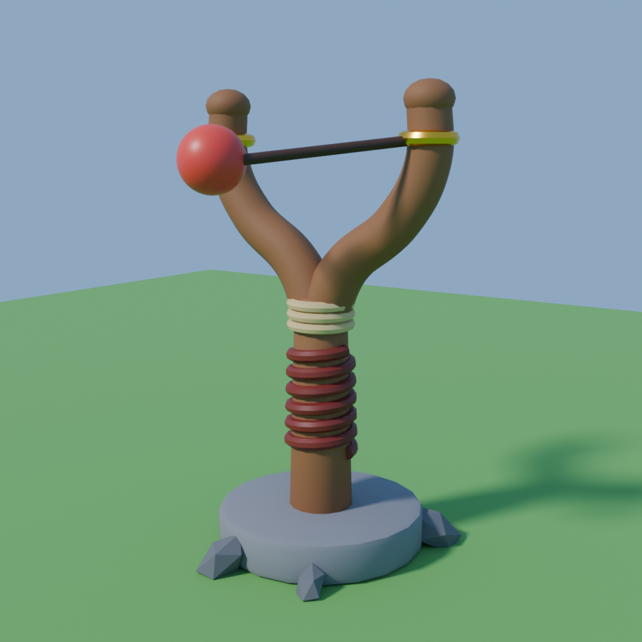

# Slingshot model (Blender → Roblox)

A cartoon wooden slingshot built in Blender: a Y-fork with a leather grip, a rope
binding, gold rings where the bands tie on, and a stone base with rocks. It's made
for the **Slingshot Phase 1** kit (drag-to-aim, bands, trajectory preview).



The bands and ball in the picture are only for the preview. In the game, the kit
draws the bands and spawns the ammo.

| File | What it is |
| --- | --- |
| `Slingshot.fbx` | The model to import into Roblox Studio |
| `SetupSlingshot.luau` | One-time setup command for Studio's Command Bar |
| `Slingshot.blend` | The Blender file, if you want to edit the model |
| `Slingshot.obj` / `.mtl` | The same model in another format (backup) |
| `build_slingshot.py` | The Blender script that builds and exports everything |
| `preview.png` | The picture above |

Size: about 8.7 studs tall and 5.3 studs wide, close to the kit's built-in
slingshot. It has 6,444 triangles across 8 pieces; the biggest piece (Fork) has 2,792.

## Put it in your game (about 3 minutes, on a PC or Mac)

1. Download `Slingshot.fbx`.
2. In Roblox Studio: **Home → Import 3D**, pick `Slingshot.fbx`.
   - Leave **Merge Meshes** off, so the pieces keep their names.
   - If it looks tiny or huge, set **Scale Unit** to **Studs** under File Dimensions.
   - Click **Import**.
3. Click the imported model so it's selected.
4. Open **View → Command Bar**, paste all of `SetupSlingshot.luau`, and press **Enter**.
   The Output window says "Slingshot is ready".
5. Move or rotate the slingshot to where you want it. It shoots toward its front.
6. Press **Play**.

The setup command:
- names the model `Slingshot`;
- gives each piece a Roblox colour and material (wood, leather, rope, gold metal, stone);
- anchors the pieces;
- adds the pieces the kit looks for: a `LaunchPoint` part where the ammo rests, facing the
  shooting direction, and `LeftTip` / `RightTip` attachments in the gold rings for the bands.

Once a model named `Slingshot` is in Workspace, the kit uses it instead of
building its own, so you don't need to change `Config`. To stop the kit from
building its test tower, set `Config.BuildDemoTargets = false`.

## Changing the model

Open `Slingshot.blend` and edit it by hand. Or change the numbers at the top of
`build_slingshot.py` (fork width, height, ring position) and run it again:

```bash
blender --background --python build_slingshot.py -- .
```

Add `--no-render` after the `.` to skip the preview picture. Keep the piece
names (`TipLeft`, `TipRight`, `Base` and so on), because the setup command looks for them.

## Not tested yet

The model was built and exported here with Blender 5.2. Re-importing the FBX into
Blender gave the right pieces, sizes and orientation. It hasn't been imported into
Roblox Studio yet, so these are unverified: the importer's exact scale, how the
pieces look with Roblox materials, and the bands lining up in play.
